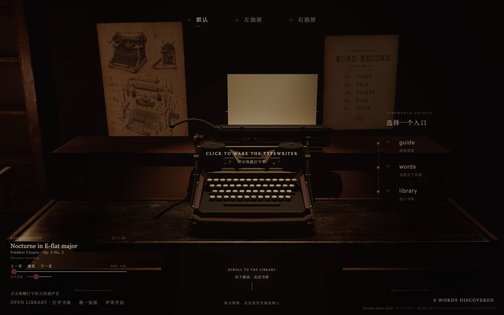
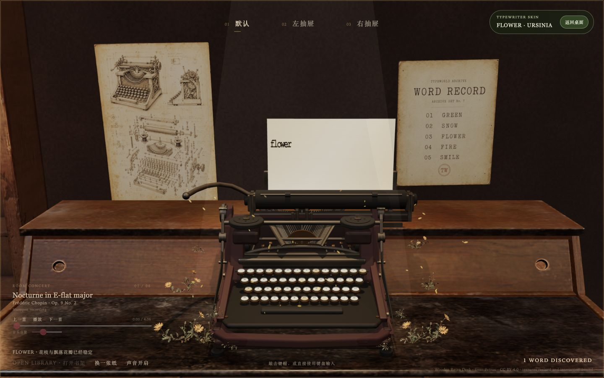
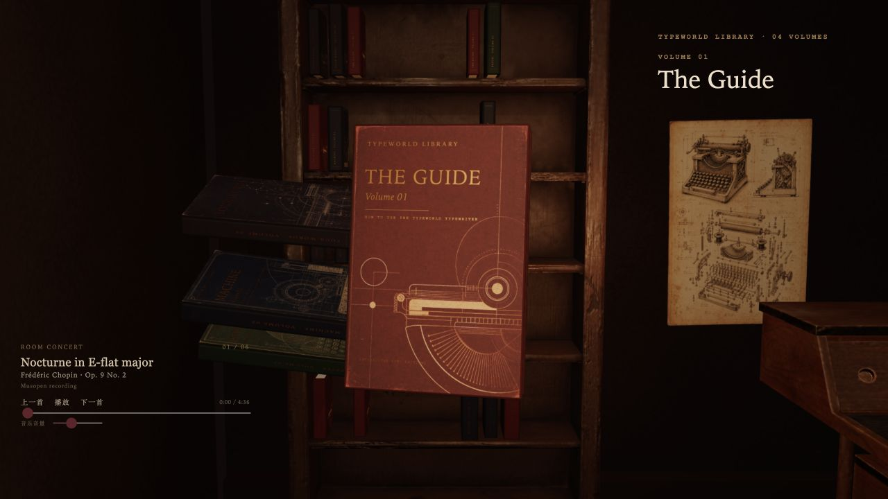

# Typeworld



Typeworld is an interactive 3D word archive built around a fictional mechanical
typewriter. Visitors can type on the machine, discover English trigger words,
watch the paper and room respond, archive printed pages in desk drawers, and
open a four-volume bilingual library.

Live site: [the0612.com](https://the0612.com)

> This is a fictional, mechanically inspired typewriter. It is not an
> engineering replica or digital twin of a historical model.

## Highlights

- Blender-generated typewriter with independently animated keys, typebars,
  carriage, platen, return lever, paper, drawers, and books.
- Three.js runtime with physical keyboard, pointer, touch, and mobile system
  keyboard input.
- Canvas-based continuous paper, drawer archives, PNG export, and print layout.
- Five starter words: `green`, `snow`, `flower`, `fire`, and `smile`.
- Desktop Study → Library camera journey and a dedicated mobile interaction
  design.
- Safari-specific five-line paper behavior and automated regression coverage.
- Full editable Blender source files and reproducible Blender Python scripts.

## Experience

### Words change the room

Type an English keyword and the paper, machine, or surrounding room responds.



### The library

Four bilingual volumes explain the interaction system and organize present and
future word effects by category.



## Quick start

Requirements:

- Node.js 24 or a compatible recent Node.js release
- npm
- Blender 5.1+ only when regenerating 3D assets

```bash
npm ci
npm run dev
```

The local site runs at `http://127.0.0.1:4173`.

## Validation

```bash
npm test
npm run typecheck
npm run build
npm run award:check
npm run assets:budget
npm audit --omit=dev --audit-level=high
```

Model regeneration and validation commands are available in `package.json`.
The generated GLB files are committed so contributors do not need Blender for
ordinary web development.

## Repository map

```text
src/                 Three.js application and interaction state
tests/               Vitest regression coverage
scripts/blender/     Reproducible Blender Python generation
assets/models/       Editable .blend sources and browser GLB outputs
assets/models/vendor Third-party models with their original licenses
assets/textures/     Runtime textures and generated visual assets
assets/audio/        Mechanical sounds, paper sound, and room music
assets/screenshots/  Real browser captures used by this README
specs/               Keyboard and vendor-model contracts
docs/                Asset provenance and technical notes
```

## Licensing

Typeworld deliberately uses separate licenses:

- Software and scripts: [MIT License](LICENSE)
- Original Typeworld models and visual assets: [CC BY 4.0](ASSET-LICENSE.md)
- Third-party assets: their original licenses, documented in
  [docs/ASSET-LICENSES.md](docs/ASSET-LICENSES.md)
- Pet archive seal: included for the runnable demo but excluded from the open
  asset grant

If you reuse an original Typeworld model, credit `Typeworld by SeanLab`, link to
this repository and CC BY 4.0, and state whether you changed it.

## Privacy

Typed documents and discovery progress are stored in the visitor's browser via
local storage. This repository does not include a server endpoint for uploading
typed document content. The production site uses Vercel Web Analytics; forks
should review or remove that integration according to their own privacy needs.

## Contributing and security

See [CONTRIBUTING.md](CONTRIBUTING.md) before opening a pull request. Please use
GitHub's private security-advisory flow for vulnerabilities, as described in
[SECURITY.md](SECURITY.md).

---

## 中文说明

Typeworld 是一座围绕虚构机械打字机展开的互动词语档案馆。用户可以输入英文、触发纸张、
打字机和房间效果，把打印结果放入抽屉，并阅读四卷中英文双语书籍。

代码和脚本采用 MIT；原创打字机 Blender/GLB 模型及原创视觉素材采用 CC BY 4.0，允许修改、
再发布和商业使用，但必须署名、附许可证链接并说明是否修改。第三方素材继续遵循各自原始
许可证，详细范围见 [ASSET-LICENSE.md](ASSET-LICENSE.md)。
